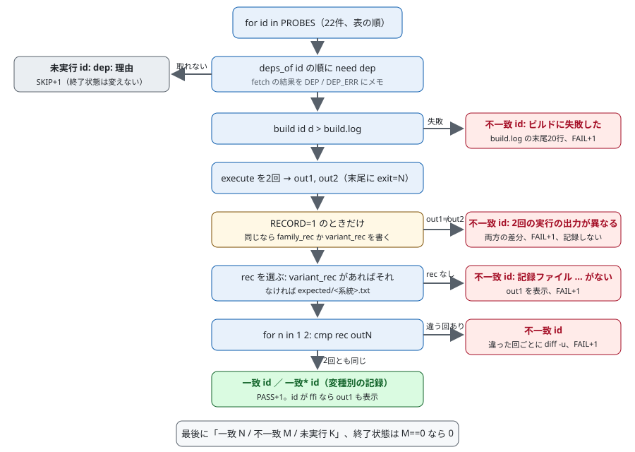
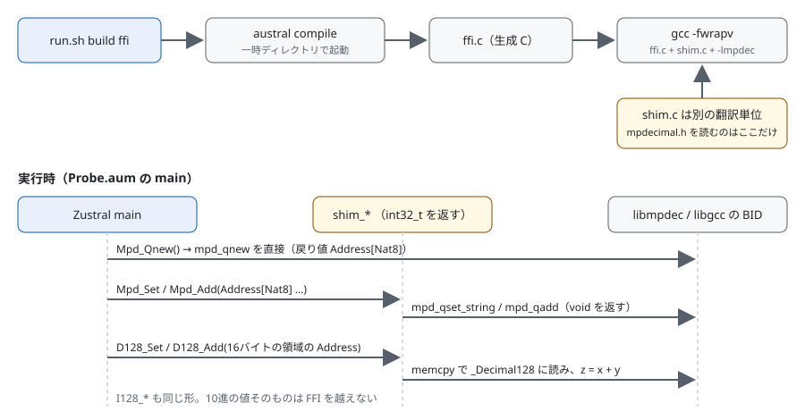

= レビューガイド: 10進バックエンドの実像を掴む（issue #1）
:toc:
:sectnums:

== 3分で分かる変更概要

何が変わるか:: `docs/research/decimal-backend-survey/` に、10進数の実行時表現の候補3系統（mpdecimal、decimal128、`__int128` 固定小数点）を比べた日本語のレポート `README.md` と、その根拠を1コマンドで再実行するスクリプト `run.sh`、小さな検証プログラム（プローブ）、記録した出力（`expected/`）を足す。
なぜ必要か:: 下流のチケット 0004・0005・0008（issue #4、#5、#8）が Decimal の型や桁あふれを決めるとき、候補の違いを「信じて」ではなく、再実行できる証拠で読めるようにするため。
どこに影響するか:: コンパイラ（`lib/`）、標準ライブラリ（`standard/`）、テスト、CI は変えない。差分は `docs/research/decimal-backend-survey/` の新規ファイルと、`docs/task-requirements/issue1-backend-docs-survey-decimal-backends/` の文書だけである。
対象外:: バックエンドの選定、decimal の実装、速度の計測、他のプラットフォームでの実測。

最初に読むのは `run.sh` である。レポートの観測できる主張は、すべてここで再実行される出力に根拠を持つ。

比較の範囲は `master...HEAD`（分岐点 `bcf6cfd3`）と、PR を仕上げる commit で足す未コミットの変更である。

== 最初に読む root

主 root:: `docs/research/decimal-backend-survey/run.sh` のメインループ（`for id in "${PROBES[@]}"` から最後の `[[ $FAIL == 0 ]]` まで）。1つのプローブが「一致」「不一致」「未実行」のどれになるかが、ここで決まる。
補助 root:: 設計文書の「データの形」の節（依存表、プローブ表、プローブの出力と結果）。`run.sh` はこの3つの表をそのままコードにしたものなので、表を先に読むとコードが追いやすい。

== 推奨する読解順

. 設計文書「データの形」。依存の名前、プローブ id（`<系統>@<コンパイラ>-<最適化>`）、結果の3値と終了状態の規則をつかむ。
. `run.sh` の `fetch` と `need`。依存を1回だけ取得してメモする仕組みと、取れなかったときの理由の作り方（`DEP_ERR`）を見る。
. `run.sh` の `deps_of`。どのプローブがどの依存を、どの順で要求するかを見る。`d128` と `libdfp` の clang 変種だけが `clang-dfp` を要求する。
. `run.sh` の `build` と `execute`。プローブごとのコンパイルの引数と、出力の末尾に `exit=<終了コード>` を足す形を見る。
. `run.sh` のメインループ。図1と照らして読む。
. `probes/i128.c`、`probes/d128.c`、`probes/mpd.c`、`probes/intel.c`、`probes/libdfp.c` と共有の `probes/bid128.h`（`print_bid128`）。どの値を `key=value` で出すかを見る。
. `probes/ffi/Probe.aum`、`probes/ffi/shim.c`、`probes/ffi/UnitReturn.aum`。図2と照らして読む。
. `expected/*.txt` と `README.md`。README の `〔probe: <記録> / <key>〕` が記録の行を指していることを確かめる。

== 実行時フロー

入力:: 引数なし（照合）か `--record`（記録の作り直し）。環境変数 `ZUSTRAL_BUILD_TIMEOUT`（既定 600 秒）。
外部 I/O:: `nix build` で固定した nixpkgs（rev `674a2028661e`）の gcc、clang、mpdecimal を取る。`curl` で libdfp（GitHub の tarball）と Intel DFP（netlib の tarball）を毎回取得し、sha256 を照合して一時ディレクトリでビルドする。`nix develop <リポジトリ直下> --command make` で Zustral コンパイラをビルドする。
一時ファイル:: すべて `mktemp -d` の `$T` に置き、`trap` で終了時に消す。例外は Zustral の `make` が作る `austral`、`_build/`、`lib/BuiltInModules.ml` で、どれも `.gitignore` 済み。
出力:: プローブごとに1行の結果と、不一致なら差分。最後に `一致 N / 不一致 M / 未実行 K`。
終了状態:: 不一致が1件以上なら 1、それ以外は 0。未実行だけでは 0 のまま。
早期終了:: ない。1つのプローブが失敗しても次へ進む。再試行もしない。

== 難しい処理

=== プローブごとの判定（`run.sh` のメインループ）

.図1. `run.sh` が1つのプローブを処理する流れ

入力:: プローブ id と、その依存の名前の列。
判断:: 依存が1つでも取れなければ未実行。取れたのにビルドが失敗したら不一致。2回の実行出力が、選んだ記録とどちらも等しければ一致、どちらかが違えば不一致。
正常時:: `一致    <id>`。変種だけの記録 `expected/<id>.txt` と等しければ `一致*  <id>（変種別の記録）`。
失敗時:: 不一致は差分か build.log の末尾を出し、最後に終了状態 1 で終わる。未実行は理由を1行で出し、終了状態を変えない。

不変条件:

* 「一致」に数えるのは、このマシンで実際にビルドして2回実行し、記録と照合したプローブだけである。
* ビルド失敗は「未実行」に混ぜない。壊れたプローブが成功に見えるのを防ぐためである。clang が `_Decimal128` を扱えないことは、ビルド失敗ではなく依存 `clang-dfp` の取得失敗として扱う。
* `--record` は、2回の出力が食い違ったプローブの記録を書かない。食い違いを記録にしてしまうと、決定性の検査が同語反復になるためである。

=== Zustral から C ライブラリを呼ぶプローブ（`ffi`）

.図2. `ffi` プローブの組み立てと実行

入力:: `probes/ffi/Probe.aum` と `probes/ffi/shim.c`。
判断:: Zustral の `Foreign_Import` は128ビット整数、レコードの値、戻り値 `Unit` を表せない（`lib/Type.ml:22-29`、`lib/CodeGen.ml:554-591`）。そのため10進の値は FFI を越えさせず、16バイトの領域や `mpd_t` へのポインタ（`Address[Nat8]`）だけを渡す。`void` を返すライブラリ関数は、`int32_t` を返す `shim_*` 関数で包む。
設計理由:: mpdecimal のヘッダを生成 C と同じ翻訳単位に入れると型が衝突した（設計文書の実験2）。だから `shim.c` を別の翻訳単位にし、リンクだけで結ぶ。
正常時:: `一致    ffi` の下に `mpd_qnew_direct=ok`、`mpd_add_01_02=0.3`、`d128_add_01_02=+3E-1`、`i128_add_01_02=0.300000000000000000`、`exit=0` が出る。
失敗時:: コンパイラのビルドが失敗するか上限を超えると、`ffi` と `ffi-unit-return` は `未実行  ffi: zustral: <理由>` になる。

== 重要コードの解説

[cols="2,3,3,2",options="header"]
|===
|シンボル |責務 |入力と出力 |副作用
|`run.sh` の `fetch` / `need`
|依存を名前で1回だけ取得し、結果か理由をメモする
|依存名 → `DEP[name]`（パス）か `DEP_ERR[name]`（理由1行）
|`nix build`、`curl`、依存のビルド（`timeout 600`）、Zustral の `make`
|`run.sh` の `build_tarball`
|tarball の取得、sha256 照合、`nix shell` の下でのビルド
|名前、URL、sha256、ビルドの命令 → `DEP` か、失敗した段（取得、sha256、configure、make）付きの `DEP_ERR`
|`$T/dep-<name>` への展開とビルド
|`run.sh` の `build`
|系統ごとのコンパイルとリンク。すべて `-fwrapv` 付き（Zustral の生成コードと同じ条件）
|id、作業ディレクトリ → `$d/bin`
|コンパイラの起動。`ffi` は一時ディレクトリで `austral compile`
|`run.sh` の `execute`
|プローブを実行し、出力の末尾に `exit=N` を足す
|id → `out1` / `out2`
|`ffi-unit-return` だけはコンパイラの起動そのものを「実行」とする
|`probes/bid128.h` の `print_bid128`
|BID 形式の16バイトを `<符号><係数>E<指数>` で出す。glibc の `printf` に `_Decimal128` の書式がないため
|キーと16バイトへのポインタ → 1行の出力
|なし
|`probes/ffi/shim.c` の `shim_d128_set`
|係数と指数から BID のビット列を直接組む
|領域、係数（`int64_t`）、指数 → 0
|領域へ16バイトを書く
|===

== テストとの対応

新しいテストファイルはない。`run.sh` の照合そのものがプローブの回帰の検査で、ランナーの分岐は失敗条件を外から起こして確かめた（実装計画「テストの方針」と「検証結果」）。

[cols="2,3,2",options="header"]
|===
|要件・シナリオ |確かめ方 |結果
|REQ-005、REQ-006、REQ-008、NFR-003
|`run.sh` を1回実行。実行の前後で作業ツリーの状態が同じか
|`一致 18 / 不一致 0 / 未実行 4`、終了状態 0。前後で同じ
|記録と食い違う出力は失敗として見える（REQ-006）
|`expected/i128.txt` の1行を書き換えて実行（改ざん）
|i128 の4変種が不一致、差分が出て `一致 14 / 不一致 4 / 未実行 4`、終了状態 1
|依存を取得できないプローブは未実行として表示される（REQ-006）
|`https_proxy=http://127.0.0.1:9` で実行（curl 遮断）
|`intel@*` と `libdfp@gcc-*` の6件が理由付きで未実行、`一致 12 / 不一致 0 / 未実行 10`、終了状態 0
|コンパイラをビルドできなければ理由を残して C だけで確かめる（REQ-007）
|`ZUSTRAL_BUILD_TIMEOUT=0.01` で実行（ビルド上限）
|`ffi` と `ffi-unit-return` が未実行、`一致 16 / 不一致 0 / 未実行 6`、終了状態 0
|clang でコンパイルできない系統は clang 比較を未実行と示す（REQ-008）
|通常の実行
|`d128@clang-*` と `libdfp@clang-*` の4件が `clang-dfp: error: GNU decimal type extension not supported` で未実行
|このマシンで観測できる主張はプローブ出力を根拠に持つ（REQ-003）
|README の `〔probe: …〕` を抜き出し、記録にキーがあるか数える
|71件すべてある
|REQ-010
|commit の後に、新しい作業ツリーで `run.sh` を実行し、issue #1 と #9 を更新する（実装計画 T8）
|このガイドの作成時点では未実施
|===

上の表の改ざん、curl 遮断、ビルド上限、`run.sh` の通常実行は、このガイドの作成直前（2026-10-26）にも実行し、同じ結果を得た。

== 重点チェック

* `run.sh` で、依存を取れた後のビルド失敗が「未実行」ではなく「不一致」に数えられているか。逆になると、壊れたプローブが成功に見える。
* `deps_of` の clang 変種で、`clang-dfp` が `d128` と `libdfp` だけに付いているか。`mpd`、`intel`、`i128` に付くと、clang で測れる決定性を測らずに未実行にしてしまう。
* `--record` で、2回の出力が食い違ったプローブの記録を書いていないか。書くと、食い違いが正解として残る。
* `shim_d128_set` は、係数が小さく指数が範囲内の値だけを正しく組む作りである。プローブが渡すのは 1E-1 と 2E-1 だけだが、この前提を読み取れるか。前提の外の値を渡すと、無効な BID のビット列ができる。
* README の各事実の文に `〔probe: …〕`、`〔run: …〕`、`〔src: …〕` のどれかが付き、他のプラットフォームの主張に「出典のみ・未実測」が付いているか。抜けると、推測が事実として下流の判断に紛れる。
* README の「下流の問いに効く事実」が、事実を挙げるだけで、特定のバックエンドを推していないか（REQ-009）。推すと、下流の壁打ちが追認になる。

== 既知の制約と対象外

* 決定性は、このマシン（x86_64 Linux）の gcc と clang、`-O0` と `-O2`、2回の実行の範囲だけを測った。ライブラリ本体は1つの最適化レベルでビルドした。
* clang 21.1.8 は `_Decimal128` を拒むので、GCC `_Decimal128` と libdfp の clang での決定性は測れない。
* GitHub のアーカイブや netlib の tarball の sha256 が将来変わると、libdfp や Intel DFP は未実行になる（失敗にはならない）。
* libdfp と Intel DFP の tarball は実行のたびにダウンロードする。ネットワークがないと、その6件は未実行になる。
* プローブは「記録との一致」しか確かめない。記録自体の正しさは、既知の値との照合（実装計画「既知の値との照合」）とレポートのレビューで確かめた。
