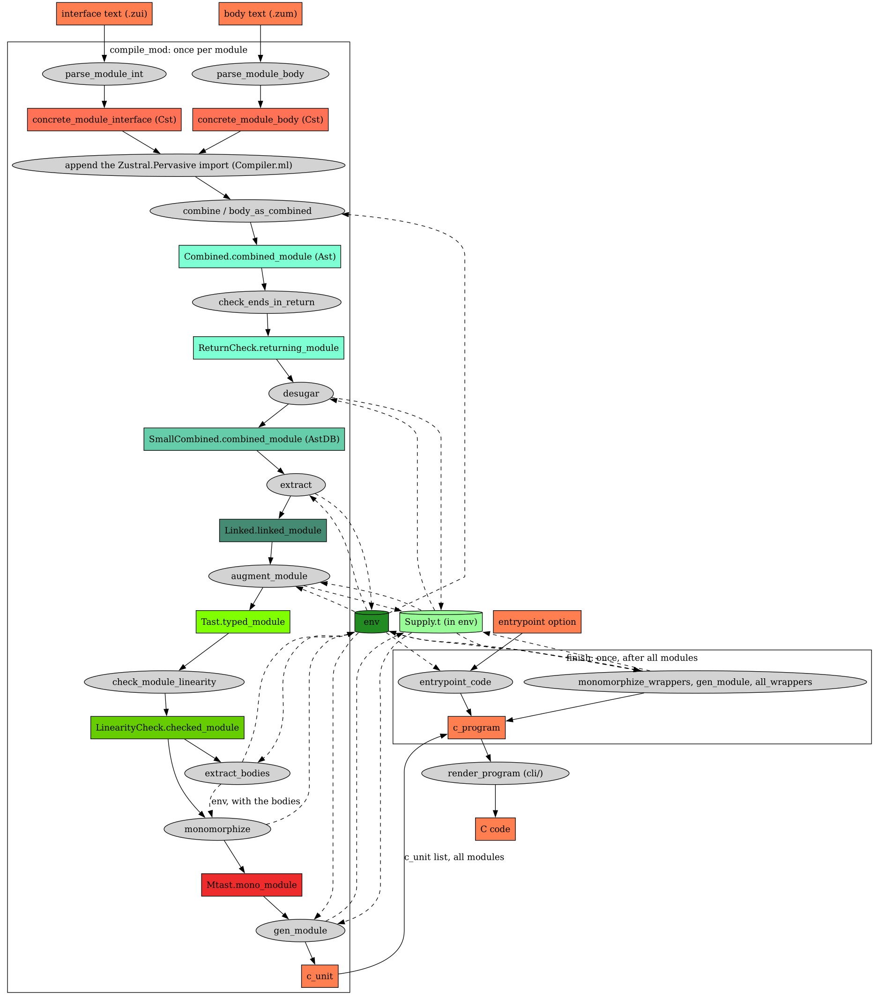

# コンパイラの流れ

この文書は、ソースから C のプログラムができるまでの段を、順にたどる。言葉は `CONTEXT.md` の「コンパイラ」の節に従う。

## 全体



図の元は `docs/pipeline.dot` である。`docs/` で `make` を実行すると、`pipeline.png` を作り直す。

段の型と、流れの全体の型は、`lib/Pipeline.mli` に1か所にまとめてある。各段のモジュールは、入口の関数にこの型を付ける。段の型を変えるときは、このファイルを変える。ビルドが、合わなくなった箇所を挙げる。

例外は、return の検査と線形性の検査である。この2つは、返す型（`ReturnCheck.returning_module`、`LinearityCheck.checked_module`）を自分のモジュールで定義する。`lib/Pipeline.mli` はその型を名指しするので、検査のモジュールが `Pipeline` の型を名指しすると、依存が輪になる。そこで、2つの検査は自分のインターフェースに型を書き、`lib/Compiler.ml` が `Pipeline.check_returns` と `Pipeline.check_linearity` の型を付けて使う。型が食い違えば、そこでビルドが止まる。

流れの全体は、次の2つの関数である。どちらも `lib/Compiler.ml` にある。

```ocaml
type compile = module_source list -> entrypoint option -> c_program Outcome.t
type check = module_source list -> unit Outcome.t
```

- `module_source` は、1つのモジュールのソースである。インターフェースと本体の2つか、本体だけである。それぞれ、ソースの文字列とファイル名を持つ。ファイルを読むのは、呼ぶ側（`cli/CliEngine.ml`）である。
- `entrypoint` は、モジュールの名前と、その中の関数の名前の組である。
- `Outcome.t` は、`('a, Outcome.errors) result` である。失敗は値で返る。`Outcome.errors` は、1 個以上のエラーの並び（`zustral_error * zustral_error list`）である。失敗したのにエラーがない、という値は作れない。
- `compile` は、組み込みモジュール（`Zustral.Pervasive`、`Zustral.Memory` の順）をコンパイルし、渡されたモジュールを順にコンパイルし、最後に1回だけ仕上げ（`finish`）を行う。
- `check` は、コマンドラインの型検査だけのモードが使う。仕上げを行わない。

1つのモジュールは、`compile_mod` が段を順につなぐ。つなぎ方は `Outcome.Syntax` の `let*` である。最初の失敗で止まる。モジュールの名前が分かった後の段が返したエラーには、`lib/Compiler.ml` がその名前を付ける（`in_module`）。

## 段の型を読む

段の型から、次のことが読める。

- `Outcome.t` を返す段は、失敗しうる。今は、すべての段が `Outcome.t` を返す。
- `env` を返す段は、環境を変える。抽出、本体の取り出し、単相化である。
- `Supply.t` を引数で受け取る段は、番号の元から番号を取る。脱糖、型検査、C の生成である。`lib/Compiler.ml` は `Env.with_supply` で環境から番号の元を取り出して渡し、段が返した番号の元を環境に戻す。抽出と単相化は、引数では受け取らない。環境の中の番号の元から、宣言の id と単相の id を取る。
- 検査の段は、検査を通ったことを表す抽象型を返す。`ReturnCheck.returning_module` と `LinearityCheck.checked_module` である。作れるのは検査の関数だけである。次の段はこの型を受け取るので、検査を飛ばすことも、順序を入れ替えることもできない。

## 構文解析

```ocaml
type 'tree parse = string -> string -> 'tree Outcome.t
```

モジュールは、インターフェースのファイル（`.zui`）と本体のファイル（`.zum`）に分かれる。本体だけのモジュールもある。`lib/ParserInterface.ml` の `parse_module_int` と `parse_module_body` が、それぞれを構文木（`Cst`）にする。引数は、ソースの文字列とファイル名である。

構文解析の後、`lib/Compiler.ml` は、インターフェースと本体に、`Zustral.Pervasive` の取り込みを足す。`Zustral.Pervasive` そのものには足さない。

## 結合

```ocaml
type combine = env -> concrete_module_interface -> concrete_module_body -> Combined.combined_module Outcome.t
type combine_body = env -> concrete_module_body -> Combined.combined_module Outcome.t
```

`lib/CombiningPass.ml` の `combine` が、インターフェースと本体を1つのモジュールにまとめる。宣言の公開の範囲は、インターフェースに現れるかどうかで決まる。本体だけのモジュールは `body_as_combined` が扱い、すべての宣言を公開にする。

結合は、取り込みを解決し（`lib/ImportResolution.ml`）、名前を修飾する。文と式は、抽象構文木（`Ast`）になる（`lib/AbstractionPass.ml`）。

安全なモジュール（`pragma Unsafe_Module;` のないモジュール）に書けないもののうち、`Zustral.Memory` からの取り込みと `@embed` の式は、この段で拒む。外部の関数の宣言（`Foreign_Import`）は、型検査が拒む。`@embed` は、任意の C の式を任意の型の値にするので、安全なモジュールで使えると、型検査と線形性の検査の保証が成り立たない。取り込みの表（`Imports.import_map`）が、取り込む側のモジュールの種類を持つ。`@embed` の式を抽象構文木にする所が、それを見る。組み込みモジュールも、`@embed` を使うので、安全でないモジュールである。

## return の検査

```ocaml
type check_returns = Combined.combined_module -> ReturnCheck.returning_module Outcome.t
```

`lib/ReturnCheck.ml` の `check_ends_in_return` が、関数とメソッドの本体が、`return` 文か `Abort` の呼び出しで終わることを確かめる。確かめるのは、文の形だけである。最後の文が `if` なら2つの枝の、`case` ならすべての枝の、`borrow` なら本体の、最後の文を見る。`else` のない `if`、`while`、`for` で終わる本体は、通らない。条件が偽のときや、ループが1回も回らないときに、`return` を通らないからである。条件が必ず真になるループも通らない。後ろに `return` 文か `Abort` の呼び出しを書く。`Abort` の呼び出しと認めるのは、その名前の変数が有効範囲にないときだけである。引数、`let`、分解、`case` の束縛、`borrow` 文が付けた名前を、本体をたどりながら集める。型検査は、呼び出しの名前と同じ名前の変数を、宣言より先に呼ぶ（`TypeCheckExpr.augment_call`）。その呼び出しは関数ポインタの呼び出しで、戻ってくる（issue #157）。外部から取り込む関数（`Foreign_Import`）は、本体がないので調べない。公開する関数（`Foreign_Export`）は、調べる。

## 脱糖

```ocaml
type desugar = Supply.t -> ReturnCheck.returning_module -> (SmallCombined.combined_module * Supply.t) Outcome.t
```

`lib/DesugaringPass.ml` の `desugar` が、文と式を、後の段が受け取る小さな言語に書き換える。3つの書き換えを順に行う。

1. 制御の持ち上げ（`lib/LiftControlPass.ml`）。出力は `AstLC` である。
2. パス式の書き換え（`lib/DesugarPaths.ml`）。出力は `AstDP` である。
3. 無名の借用の書き換え（`lib/DesugarBorrows.ml`）。出力は `AstDB` である。

無名の借用は、それを書いた文を包む `borrow` 文になる。借用は、その文が終わると終わる。レコードを分解する `let` は、後に続く文を本体として持つ。値に無名の借用があるときは、値を一時変数に入れる文を作り、その文だけを包む。借用は、値を計算し終えたところで終わり、本体には及ばない。変数を1つ宣言する `let` と同じである。

脱糖が出す利用者のエラーは、定数の値の中の借用の1つである。借用を包む文がないからである。

## 抽出

```ocaml
type extract = env -> SmallCombined.combined_module -> (env * Linked.linked_module) Outcome.t
```

`lib/ExtractionPass.ml` の `extract` が、宣言を環境に登録し、シグネチャの型を読む。最初に、モジュールのすべてのレコードと union の id を、環境から予約する。シグネチャの型は、宣言を登録する前に読むが、名前のある型は、予約した id を持てる。後の段は、その id で宣言を取り出す。関数とメソッドの本体は、まだ登録しない。出力の `Linked` では、宣言が、環境の中の id を持つ。

## 型検査

```ocaml
type check_types = env -> Supply.t -> Linked.linked_module -> (Tast.typed_module * Supply.t) Outcome.t
```

`lib/TypingPass.ml` の `augment_module` が、文と式に型を付ける。出力は `Tast` である。借用の領域の番号を、番号の元から取る。

`let` が宣言する変数は、初期値を代入する文が終わるまで、値を持たない。字句環境（`lib/LexEnv.ml`）は、その間、変数に「初期値を待っている」という印を付ける。名前は取られているが、変数は見つからない。初期値の式からも、初期値の中の無名の借用やパスからも、宣言している変数は見えない（issue #154）。

式の型検査の入口は、`lib/TypeCheckExpr.mli` の3つである。

- `infer` は、式から型を求める。
- `check` は、式が、与えた型を持つことを確かめる。
- `check_annotated` は、型注釈（`e : T` と `let x: T := e`）の位置で使う。`check` と違う点は2つある。整数と浮動小数点数のリテラルに、注釈の型へのキャストの節を付ける。整数は、その型に収まらなければエラーである。書き込みの参照を、同じ型と領域の読み取りの参照に変える。これも、キャストの節になる。ほかの式が注釈の型を持たなければ、キャストが無効だというエラーになる。

型変数は、型の照合での扱いを自分で持つ（`lib/Type.mli` の `type_var_matching`）。扱いは2つある。

- `StandsForItself`（それ自身を表す）。宣言されたとおりの型、つまりシグネチャと本体の中の型引数である。宣言の中では、型引数は1つの決まった型で、それ自身とだけ同じである。照合は、これを束縛しない。束縛すると、本体が、1つの型引数のときだけ正しければ通ってしまう（issue #151）。
- `BoundAtUse`（使う所で束縛される）。宣言を使う所での、シグネチャの型の中の型引数である。照合は、これを、使う側の型に束縛する。

束縛するかどうかを決めるのは、`TypeMatch.try_match_type_var` の1か所である。宣言を使う所は、シグネチャの型を `SignatureTypeAtUse.signature_type_at_use` に通してから、`match_type` に渡す。使う所は、次のとおりである。新しい所を足すときに、これを通し忘れると、型引数は束縛されず、正しいプログラムが型エラーになる。誤ったプログラムが通ることはない。

- 関数とメソッドの呼び出し、レコードと union の構築（`TypeCheckExpr.augment_callable`）。
- 汎用の関数を、関数ポインタとして使う所（`augment_variable`）。
- インスタンスを探す所（`TypeMatch.try_get_instance_among`）。
- レコードの欄を読む所、レコードの分解、`case` 文。宣言された型を値の型と照らして、型引数を取り出す。

汎用の関数が自分を呼ぶと、呼ぶ側の `T` はそれ自身を表し、呼ばれる側の `T` は使う所で束縛される。2つは別の型変数で、呼び出しは、呼ばれる側の `T` を呼ぶ側の `T` に束縛する（issue #156）。インスタンスの型引数は、型クラスを出どころとして持つ。同じ型クラスの2つのインスタンスが、型引数に同じ名前を付けていても、片方がもう片方のメソッドを呼ぶときに、同じように区別される。

本体の中の2つの型を比べる所では、束縛は起きない。どちらの型の型変数も、それ自身を表すからである。`expect_same_type` と `expect_value_of_type` は、この比較に使う。型が違えば、2つの型の全体を挙げて、型が合わないと報告する。本体の中の比較は、次の所にある。

- `return` の値、代入の右辺、分解の束縛、`check` に渡した型。
- 型注釈の位置（`let` の型と `e : T`）。
- 関数ポインタの呼び出しの引数と、その呼び出しの型。関数ポインタは、自分の型引数を持たない。呼び出しの型は、関数ポインタの型の戻り値の型そのものである。
- 比較の2つの辺と、算術の演算子の2つの辺。片方だけが数値リテラルのとき、リテラルは、もう片方の型になる。その型が型変数なら、エラーである。型変数の位置には、リテラルを書けない（issue #25）。単項のマイナス（`-x`）は、被演算子の型を持つ。型変数の型の値は、型変数に `TrappingArithmetic` の制約があれば受け付ける。単相化が、その型変数に与えられた型が符号付きの整数型か浮動小数点数型であることを確かめる（issue #26、#162）。

呼び出しの型は、宣言された戻り値の型に、束縛を当てはめたものである（`handle_return_type_polymorphism`）。戻り値の型に、どの引数の型にも出ない型引数があるときは、呼び出しの位置が、その型引数を決める。位置の求める型を、宣言された戻り値の型の全体と照らすので、位置は、引数が束縛した型引数にも型を与える。その型が、引数の与えた型と違えば、型が合わないというエラーである。束縛は、宣言された戻り値の型に、1回だけ当てはめる。当てはめて入ってきた型の中の型引数は、囲んでいる宣言のもので、置き換えない。自分を呼ぶ呼び出しでは、その型引数が、束縛を持つ型引数と同じ名前を持つ。

数値リテラルだけに当てはまる規則は、`lib/LiteralTyping.ml` にある。

整数リテラルは、自分の型を持たない。型が届く位置では、届いた型になり、その型に収まらなければエラーである。型の届かない位置では、既定の型 `Int32` になり、`Int32` に収まらなければエラーである（issue #155）。型の届かない位置とは、型引数に束縛される引数（`printLn(5)`）、`if` 式の枝、リテラルどうしの比較、`@embed` の引数などである。スパンの添字（`s[i]`）は、型が届く位置である。添字は `Index` でなければならず、`check` で `Index` と照らす（issue #158）。リテラルの添字は `Index` になる。ほかの整数型の変数は、添字にできない。枝がリテラルの `if` 式（`s[if b then 0 else 1]`）も、型が `Int32` なので、添字にできない。`let x: Index := if b then 0 else 1;` と同じである。`infer` は、型の届かない位置の式に使う。整数リテラルを、ここで既定の型に照らす。引数、演算子の片方だけのリテラル、`check` と `check_annotated` に渡した式は、後で位置の型と照らす。位置の型が整数型でないとき、`expect_value_of_type` は、型が合わないというエラーにする。`match_type_with_value` は、型引数をリテラルの既定の型に束縛するので、リテラルを既定の型に照らす。

## 線形性の検査

```ocaml
type check_linearity = Tast.typed_module -> LinearityCheck.checked_module Outcome.t
```

`lib/LinearityCheck.ml` の `check_module_linearity` が、線形の値がちょうど1回使われることと、借用の規則を調べる。関数とメソッドの本体を、1つずつ、実行の順にたどる。

たどりながら、状態の表を持つ。表は、変数ごとに、型と、使用の状態（`var_state`）を持つ。状態は `Unconsumed`、`BorrowedRead`、`BorrowedWrite`、`Consumed` の4つである。

規則は、次のとおりである。表には、宇宙を問わず、すべての変数が入る。`Consumed` になり、エラーが出るのは、宇宙が `Linear` か `Type` の変数だけである。例外は、`borrow` 文のエラー（規則 5）と、借用されている変数への代入のエラー（規則 8）で、どの宇宙の変数にも出る。

1. 引数を、`Unconsumed` で表に入れる。`let` や `case` の束縛も、同じに入れる。
2. 式を調べるとき、表の変数ごとに、式の中で使われた回数を数える。`if` 式は、2つの枝のどちらかだけを評価するので、枝の回数は足さない。2つの枝で回数が同じなら、その回数を数える。片方の枝だけが使えば、エラーである。`and` と `or` の右辺は、左辺で結果が決まると評価しない。右辺が使えば、エラーである。書き込みの参照と書き込みのスパンは、使わずに捨ててよいので、片方の枝や右辺だけで使える。そのときは、使ったものとして扱う。式の後でもう一度使うと、エラーである。`Unconsumed` の変数を1回使うと、`Consumed` になる。2回以上使うとエラーである。借用されている変数や、もう使った変数を使うのもエラーである。
3. ループの本体は、0 回も、何回も回る。本体をたどる前と後で、変数の状態が同じでなければならない。本体で使って代入し直していない変数も、ループの前に使ってあって本体で代入したままの変数も、エラーである。宇宙が `Linear` か `Type` の変数だけを比べる。
4. `if` は、2つの枝を別々にたどり、両方の表にある変数の状態が同じことを確かめる。宇宙が `Linear` か `Type` の変数だけを比べる。`case` は、すべての枝の表を、1つの枝の表と比べる。どの枝の後でも、変数の状態は同じになる。
5. `borrow` 文は、元の変数が `Unconsumed` であること（読み取りの借用なら、`BorrowedRead` でもよい）を確かめ、本体をたどる間、`BorrowedRead` か `BorrowedWrite` にする。本体の後で、借用の前の状態に戻す。読み取りの借用は、読み取りの借用の中でも行える。そのとき、元の変数は借用の前から `BorrowedRead` なので、内側の借用が終わっても `BorrowedRead` のままである。
6. `return` 文では、表のすべての変数が `Consumed` でなければならない。書き込みの参照と書き込みのスパンは、使わずに捨ててよい。
7. 束縛の範囲を出るとき、その変数が `Consumed` でなければエラーである。書き込みの参照と書き込みのスパンは除く。
8. 使った変数に代入すると、`Unconsumed` に戻る。使っていない変数への代入はエラーである。借用されている変数への代入は、どの宇宙の変数でもエラーである。

式の中で数えるのは、変数が使われた回数だけである。無名の借用（`&x`、`&!x`、借り直しの `&~x`）は、脱糖が `borrow` 文に書き換えている。

## 本体の取り出し

```ocaml
type extract_bodies = env -> LinearityCheck.checked_module -> env Outcome.t
```

`lib/BodyExtractionPass.ml` の `extract_bodies` が、関数とインスタンスのメソッドの本体を、環境に入れる。汎用の関数を単相化するときに、本体が要るからである。失敗は、環境の内部エラーだけである。

## 単相化

```ocaml
type monomorphize = env -> LinearityCheck.checked_module -> (env * Mtast.mono_module) Outcome.t
```

`lib/Monomorphize.ml` の `monomorphize` が、汎用の宣言を、使われている型ごとの宣言に展開する。出力は `Mtast` である。単相は環境に登録する。単相の本体の中で、さらに別の単相が見つかれば、それも登録する。新しい単相がなくなるまで繰り返す。汎用の本体の型変数は、型引数の型で置き換える。型引数が名前のある型なら、名前のある型をそのまま入れる。置き換えた後の木は、汎用でないソースを型検査した木と同じ形である。単相化の後の型（`MonoType.mono_ty`）には、型変数が残らない。領域は、実行時の値を持たないので、どれも `Static` になる。関数とメソッドの単相の領域の型引数も、レコードと union の単相の領域の型引数も、借用の領域も同じである。そのため、`Tag[Rho]` と `Tag[Static]` は1つの単相になり、領域の型引数を取る関数に、借用の領域のレコードを渡せる（issue #142）。

## C の生成

```ocaml
type generate = env -> Supply.t -> Mtast.mono_module -> (c_unit * Supply.t) Outcome.t
```

`lib/CodeGen.ml` の `gen_module` が、`Mtast` のモジュールから、C の構文木（`lib/CRepr.ml`）の1つの単位を作る。C の変数の番号を、番号の元から取る。この段のコードは、例外を投げる箇所を持たない。型は `Outcome.t` のままである。中で呼ぶ環境の検索が、内部エラーを出しうるためである。

## 仕上げ

```ocaml
type finish = env -> c_unit list -> entrypoint option -> c_program Outcome.t
```

すべてのモジュールの後に、`lib/Compiler.ml` の `finish` が1回だけ動く。

1. 公開する関数を単相化する（`Monomorphize.monomorphize_wrappers`）。その C を、1つの単位として作る。
2. 公開する関数の包みを作る（`lib/ExportInstantiation.ml` の `all_wrappers`）。
3. エントリポイントが与えられていれば、その C を作る（`lib/Entrypoint.ml` の `entrypoint_code`）。

出力の `c_program` は、C の前置き（`lib/prelude.c`）、モジュールごとの単位、公開する関数の単相の単位、包みの単位、エントリポイントを、書き出す順に持つ。

## 文字列にする

C のプログラムを文字列にするのは、端である。`cli/CliEngine.ml` が、`lib/CRenderer.ml` の `render_program` を1回だけ呼ぶ。端は、その文字列をファイルに書き、実行ファイルを作るときは `cc` を呼ぶ。
