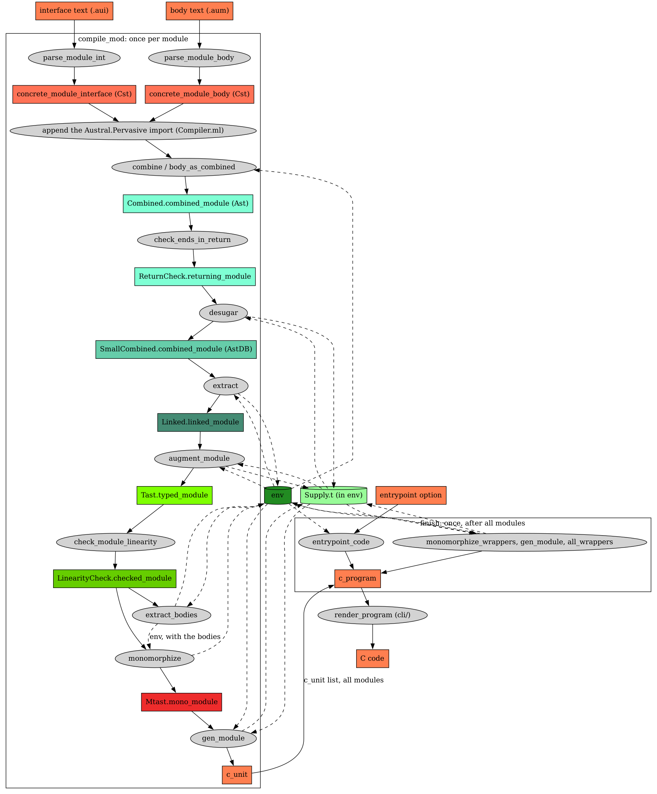

# コンパイラの流れ

この文書は、ソースから C のプログラムができるまでの段を、順にたどる。言葉は `CONTEXT.md` の「コンパイラ」の節に従う。

## 全体



図の元は `docs/pipeline.dot` である。`docs/` で `make` を実行すると、`pipeline.png` を作り直す。

段の型と、流れの全体の型は、`lib/Pipeline.mli` に1か所にまとめてある。各段のモジュールは、入口の関数にこの型を付ける。段の型を変えるときは、このファイルを変える。ビルドが、合わなくなった箇所を挙げる。

例外は、return の検査と線形性の検査である。この2つは、返す型（`ReturnCheck.returning_module`、`LinearityCheck.checked_module`）を自分のモジュールで定義する。`lib/Pipeline.mli` はその型を名指しするので、検査のモジュールが `Pipeline` の型を名指しすると、依存が輪になる。そこで、2つの検査は自分のインターフェースに型を書き、`lib/Compiler.ml` が `Pipeline.check_returns` と `Pipeline.check_linearity` の型を付けて使う。型が食い違えば、そこでビルドが止まる。

流れの全体は、次の2つの関数である。どちらも `lib/Compiler.ml` にある。

```ocaml
type compile = module_source list -> entrypoint option -> c_program Outcome.t
type check = module_source list -> unit Outcome.t
```

- `module_source` は、1つのモジュールのソースである。インターフェースと本体の2つか、本体だけである。それぞれ、ソースの文字列とファイル名を持つ。ファイルを読むのは、呼ぶ側（`cli/CliEngine.ml`）である。
- `entrypoint` は、モジュールの名前と、その中の関数の名前の組である。
- `Outcome.t` は、`('a, austral_error list) result` である。失敗は値で返る。
- `compile` は、組み込みモジュール（`Austral.Pervasive`、`Austral.Memory` の順）をコンパイルし、渡されたモジュールを順にコンパイルし、最後に1回だけ仕上げ（`finish`）を行う。
- `check` は、コマンドラインの型検査だけのモードが使う。仕上げを行わない。

1つのモジュールは、`compile_mod` が段を順につなぐ。つなぎ方は `Outcome.Syntax` の `let*` である。最初の失敗で止まる。モジュールの名前が分かった後の段が返したエラーには、`lib/Compiler.ml` がその名前を付ける（`in_module`）。

## 段の型を読む

段の型から、次のことが読める。

- `Outcome.t` を返す段は、失敗しうる。今は、すべての段が `Outcome.t` を返す。
- `env` を返す段は、環境を変える。抽出、本体の取り出し、単相化である。
- `Supply.t` を引数で受け取る段は、番号の元から番号を取る。脱糖、型検査、C の生成である。`lib/Compiler.ml` は `Env.with_supply` で環境から番号の元を取り出して渡し、段が返した番号の元を環境に戻す。抽出と単相化は、引数では受け取らない。環境の中の番号の元から、宣言の id と単相の id を取る。
- 検査の段は、検査を通ったことを表す抽象型を返す。`ReturnCheck.returning_module` と `LinearityCheck.checked_module` である。作れるのは検査の関数だけである。次の段はこの型を受け取るので、検査を飛ばすことも、順序を入れ替えることもできない。

## 構文解析

```ocaml
type 'tree parse = string -> string -> 'tree Outcome.t
```

モジュールは、インターフェースのファイル（`.aui`）と本体のファイル（`.aum`）に分かれる。本体だけのモジュールもある。`lib/ParserInterface.ml` の `parse_module_int` と `parse_module_body` が、それぞれを構文木（`Cst`）にする。引数は、ソースの文字列とファイル名である。

構文解析の後、`lib/Compiler.ml` は、インターフェースと本体に、`Austral.Pervasive` の取り込みを足す。`Austral.Pervasive` そのものには足さない。

## 結合

```ocaml
type combine = env -> concrete_module_interface -> concrete_module_body -> Combined.combined_module Outcome.t
type combine_body = env -> concrete_module_body -> Combined.combined_module Outcome.t
```

`lib/CombiningPass.ml` の `combine` が、インターフェースと本体を1つのモジュールにまとめる。宣言の公開の範囲は、インターフェースに現れるかどうかで決まる。本体だけのモジュールは `body_as_combined` が扱い、すべての宣言を公開にする。

結合は、取り込みを解決し（`lib/ImportResolution.ml`）、名前を修飾する。文と式は、抽象構文木（`Ast`）になる（`lib/AbstractionPass.ml`）。

## return の検査

```ocaml
type check_returns = Combined.combined_module -> ReturnCheck.returning_module Outcome.t
```

`lib/ReturnCheck.ml` の `check_ends_in_return` が、関数とメソッドの本体が、`return` 文か `Abort` の呼び出しで終わることを確かめる。確かめるのは、文の形だけである。最後の文が `while`、`for`、`borrow` なら、その本体の最後の文を見る。ループが1回も回らない場合は、考えない。`else` のない `if` で終わる関数も通る（issue #89）。プラグマの付いた関数は、調べない。

## 脱糖

```ocaml
type desugar = Supply.t -> ReturnCheck.returning_module -> (SmallCombined.combined_module * Supply.t) Outcome.t
```

`lib/DesugaringPass.ml` の `desugar` が、文と式を、後の段が受け取る小さな言語に書き換える。3つの書き換えを順に行う。

1. 制御の持ち上げ（`lib/LiftControlPass.ml`）。出力は `AstLC` である。
2. パス式の書き換え（`lib/DesugarPaths.ml`）。出力は `AstDP` である。
3. 無名の借用の書き換え（`lib/DesugarBorrows.ml`）。出力は `AstDB` である。

脱糖が出す利用者のエラーは、定数の値の中の借用の1つである。借用を包む文がないからである。

## 抽出

```ocaml
type extract = env -> SmallCombined.combined_module -> (env * Linked.linked_module) Outcome.t
```

`lib/ExtractionPass.ml` の `extract` が、宣言を環境に登録し、シグネチャの型を読む。関数とメソッドの本体は、まだ登録しない。出力の `Linked` では、宣言が、環境の中の id を持つ。

## 型検査

```ocaml
type check_types = env -> Supply.t -> Linked.linked_module -> (Tast.typed_module * Supply.t) Outcome.t
```

`lib/TypingPass.ml` の `augment_module` が、文と式に型を付ける。出力は `Tast` である。借用の領域の番号を、番号の元から取る。

式の型検査の入口は、`lib/TypeCheckExpr.mli` の3つである。

- `infer` は、式から型を求める。
- `check` は、式が、与えた型を持つことを確かめる。
- `check_annotated` は、型注釈（`e : T` と `let x: T := e`）の位置で使う。`check` と違う点は2つある。整数と浮動小数点数のリテラルに、注釈の型へのキャストの節を付ける。整数は、その型に収まらなければエラーである。書き込みの参照を、同じ型と領域の読み取りの参照に変える。これも、キャストの節になる。ほかの式が注釈の型を持たなければ、キャストが無効だというエラーになる。

数値リテラルだけに当てはまる規則は、`lib/LiteralTyping.ml` にある。

## 線形性の検査

```ocaml
type check_linearity = Tast.typed_module -> LinearityCheck.checked_module Outcome.t
```

`lib/LinearityCheck.ml` の `check_module_linearity` が、線形の値がちょうど1回使われることと、借用の規則を調べる。関数とメソッドの本体を、1つずつ、実行の順にたどる。

たどりながら、次の2つを持つ。

- ループの深さ。ループの本体に入ると1つ増える。
- 状態の表。変数ごとに、型、定義したときのループの深さ、使用の状態（`var_state`）を持つ。状態は `Unconsumed`、`BorrowedRead`、`BorrowedWrite`、`Consumed` の4つである。表は、ループの中で使った変数の一覧も持つ。

規則は、次のとおりである。表には、宇宙を問わず、すべての変数が入る。`Consumed` になり、エラーが出るのは、宇宙が `Linear` か `Type` の変数だけである。例外は `borrow` 文のエラー（規則 5）で、どの宇宙の変数にも出る。

1. 引数を、深さ 0、`Unconsumed` で表に入れる。`let` や `case` の束縛も、そのときの深さで入れる。
2. 式を調べるとき、表の変数ごとに、式の中で使われた回数を数える。`Unconsumed` の変数を1回使うと、`Consumed` になる。2回以上使うとエラーである。借用されている変数や、もう使った変数を使うのもエラーである。
3. 定義したときと違う深さで使った変数は、ループの中で使った変数の一覧に入る。ループを出るとき、ループの中で使って、代入し直していない変数があれば、エラーである。
4. `if` は、2つの枝を別々にたどり、両方の表にある変数の状態が同じことを確かめる。宇宙が `Linear` か `Type` の変数だけを比べる。`case` は、枝の表を、union の case の宣言の並びで（書いた順ではない）、重ならない2つずつの組にして比べる。1つ目と2つ目、3つ目と4つ目、である。組どうしは比べない。枝の数が奇数なら、最後の枝は何とも比べない。そのため、枝が 3 個以上あると、線形の値を消費しない枝を見逃すことがある（issue #129）。
5. `borrow` 文は、元の変数が `Unconsumed` であることを確かめ、本体をたどる間、`BorrowedRead` か `BorrowedWrite` にする。本体の後で、`Unconsumed` に戻す。読み取りの借用は、読み取りの借用の中でも行える。内側の借用が終わったときにも `Unconsumed` に戻すので、外側の借用がまだ続いているのに、元の変数を使えてしまう（issue #134）。
6. `return` 文では、表のすべての変数が `Consumed` でなければならない。書き込みの参照と書き込みのスパンは、使わずに捨ててよい。
7. 束縛の範囲を出るとき、その変数が `Consumed` でなければエラーである。書き込みの参照と書き込みのスパンは除く。
8. 使った変数に代入すると、`Unconsumed` に戻る。使っていない変数への代入はエラーである。

式の中で数えるのは、変数が使われた回数だけである。無名の借用（`&x`、`&!x`、借り直しの `&~x`）は、脱糖が `borrow` 文に書き換えている。

## 本体の取り出し

```ocaml
type extract_bodies = env -> LinearityCheck.checked_module -> env Outcome.t
```

`lib/BodyExtractionPass.ml` の `extract_bodies` が、関数とインスタンスのメソッドの本体を、環境に入れる。汎用の関数を単相化するときに、本体が要るからである。失敗は、環境の内部エラーだけである。

## 単相化

```ocaml
type monomorphize = env -> LinearityCheck.checked_module -> (env * Mtast.mono_module) Outcome.t
```

`lib/Monomorphize.ml` の `monomorphize` が、汎用の宣言を、使われている型ごとの宣言に展開する。出力は `Mtast` である。単相は環境に登録する。単相の本体の中で、さらに別の単相が見つかれば、それも登録する。新しい単相がなくなるまで繰り返す。単相化の後の型（`MonoType.mono_ty`）に残る型変数は、領域の型変数（`MonoRegionTyVar`）だけである。

## C の生成

```ocaml
type generate = env -> Supply.t -> Mtast.mono_module -> (c_unit * Supply.t) Outcome.t
```

`lib/CodeGen.ml` の `gen_module` が、`Mtast` のモジュールから、C の構文木（`lib/CRepr.ml`）の1つの単位を作る。C の変数の番号を、番号の元から取る。前の段の型がまだ締め出していない状態に備えて、内部エラーを出しうる（issue #117）。

## 仕上げ

```ocaml
type finish = env -> c_unit list -> entrypoint option -> c_program Outcome.t
```

すべてのモジュールの後に、`lib/Compiler.ml` の `finish` が1回だけ動く。

1. 公開する関数を単相化する（`Monomorphize.monomorphize_wrappers`）。その C を、1つの単位として作る。
2. 公開する関数の包みを作る（`lib/ExportInstantiation.ml` の `all_wrappers`）。
3. エントリポイントが与えられていれば、その C を作る（`lib/Entrypoint.ml` の `entrypoint_code`）。

出力の `c_program` は、C の前置き（`lib/prelude.c`）、モジュールごとの単位、公開する関数の単相の単位、包みの単位、エントリポイントを、書き出す順に持つ。

## 文字列にする

C のプログラムを文字列にするのは、端である。`cli/CliEngine.ml` が、`lib/CRenderer.ml` の `render_program` を1回だけ呼ぶ。端は、その文字列をファイルに書き、実行ファイルを作るときは `cc` を呼ぶ。
